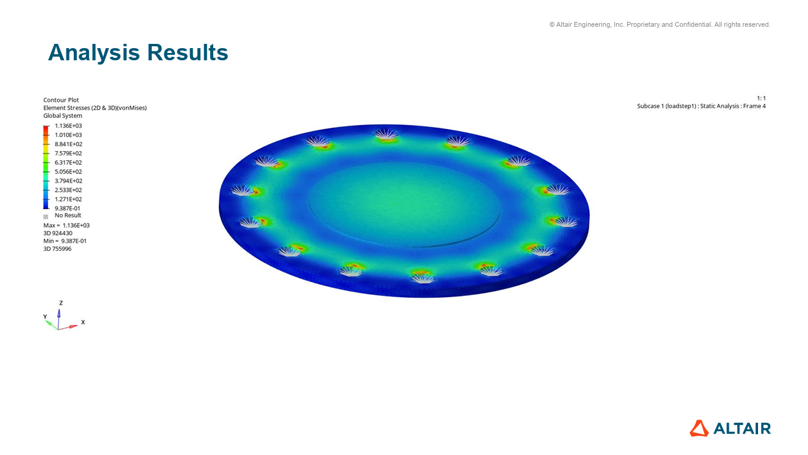
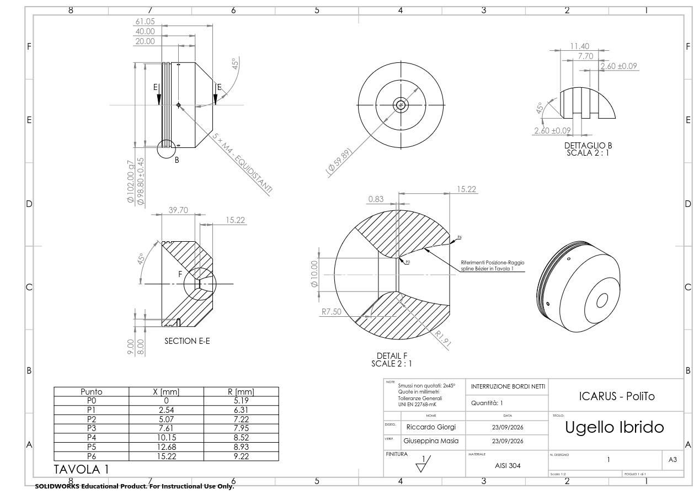

My engineering studies and work with Team Icarus combine design, simulation and practical teamwork.

- **SolidWorks:** parametric 3D modelling and structural component design for the APA project, with attention to manufacturing specifications.
- **HyperMesh & HyperView:** FEA model preparation, meshing, applying loads and evaluating structural results.
- **Python:** scripting, data handling and automation for university work and technical projects.
- **MATLAB:** numerical modelling and mechanical engineering coursework.
- **Git:** Source control I use for almost any digtal project.

### Injector FEA

### Nozzle CAD drawing

[Team Icarus — Advanced Propulsion Aircraft](https://icarus.polito.it/apa-2025/)
