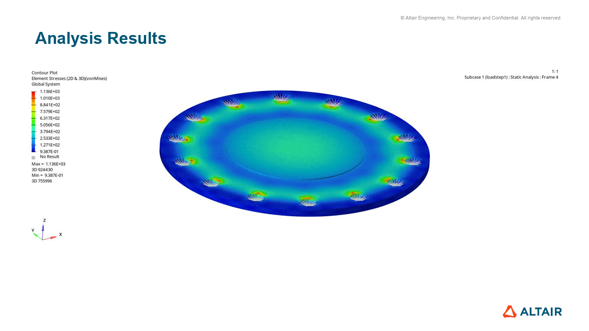
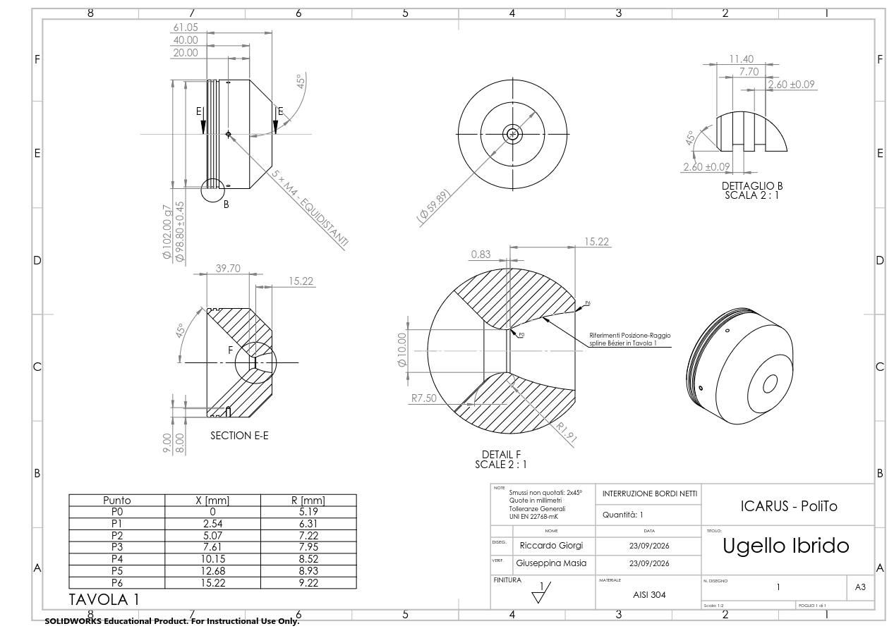

Gli studi di ingegneria e il lavoro con il Team Icarus mi permettono di unire progettazione, simulazione e collaborazione pratica.

- **SolidWorks:** modellazione 3D parametrica e progettazione strutturale di componenti per il progetto APA, con attenzione alle specifiche di produzione.
- **HyperMesh e HyperView:** preparazione dei modelli per l’analisi agli elementi finiti, generazione della mesh, applicazione dei carichi e valutazione dei risultati strutturali.
- **Python:** scripting, gestione dei dati e automazione per le attività universitarie e i progetti tecnici.
- **MATLAB:** modellazione numerica e attività didattiche del corso di Ingegneria Meccanica.
- **Git:** controllo di versione che uso per quasi tutti i miei progetti digitali.

### Analisi agli elementi finiti di un iniettore

### Disegno tecnico di un ugello

[Team Icarus — Advanced Propulsion Aircraft](https://icarus.polito.it/apa-2025/)
