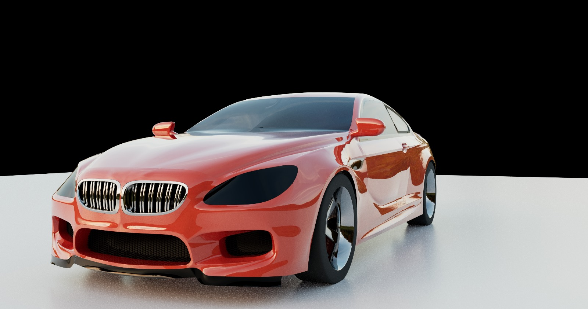

I use 3D modelling to support design visualisation, prototyping and technical projects.

- **Autodesk Maya:** advanced polygonal modelling and texturing. I completed Istituto Volta’s remote Car Design course on 17 April 2025.
- **Blender:** 3D modelling software for quick mockups and models I use for my game development hobby. I have over 250 hrs of hands-on experience with the tool (source: Steam usage time).

### BMW Model made in Maya

[Verify my Maya credential on Credly](https://www.credly.com/badges/286b9940-d45e-47c7-855e-a76377268bc5/)
