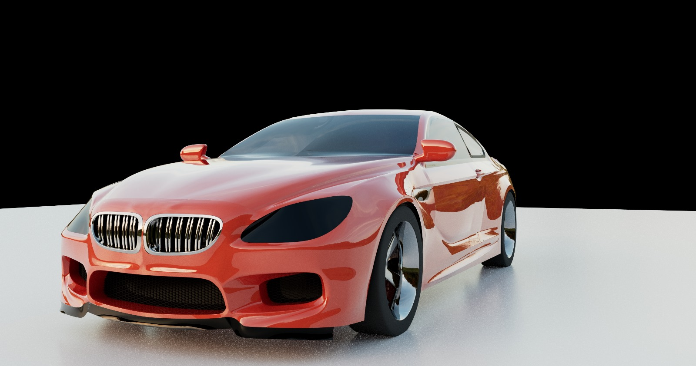

Uso la modellazione 3D a supporto della visualizzazione dei progetti, della prototipazione e delle attività tecniche.

- **Autodesk Maya:** modellazione poligonale avanzata e texturing. Ho completato il corso di Car Design a distanza dell’Istituto Volta il 17 aprile 2025.
- **Blender:** software di modellazione 3D che utilizzo per creare rapidamente bozze e modelli per i miei progetti di videogiochi. Ho oltre 250 ore di esperienza pratica con lo strumento (fonte: tempo di utilizzo su Steam).

### Modello BMW realizzato in Maya

[Verifica la mia certificazione Maya su Credly](https://www.credly.com/badges/286b9940-d45e-47c7-855e-a76377268bc5/)
