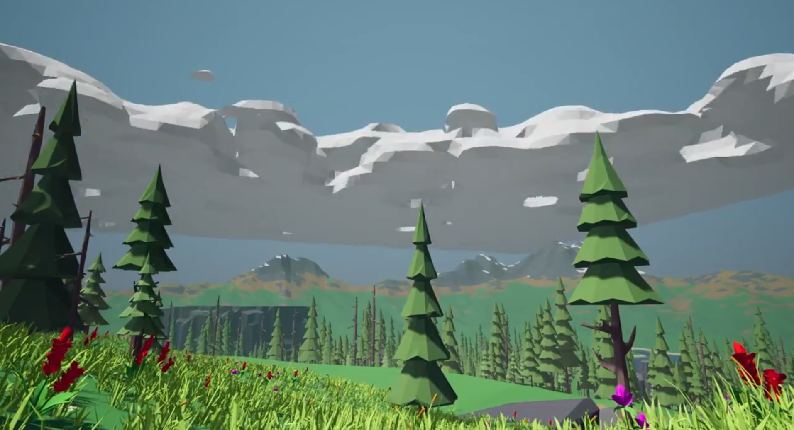
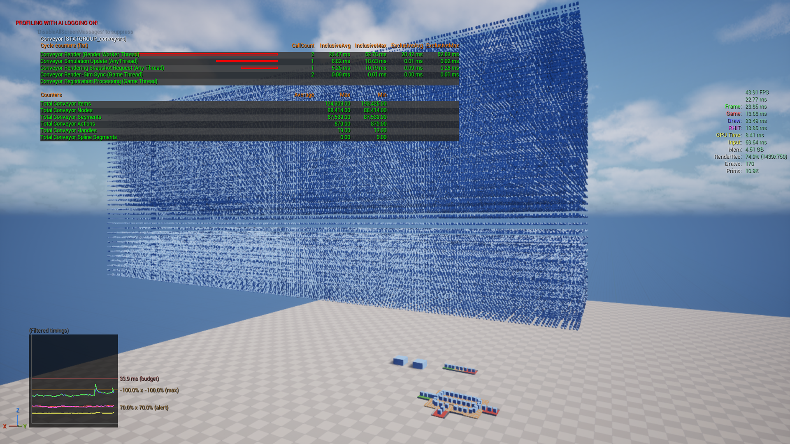

Programming is a long-standing interest and a supporting skill for my engineering work.

- **C++:** personal projects, algorithms and commercial development, with a focus on performance and system architecture ([Example project](https://github.com/Theuntextured/LineCounter)).
- **Unreal Engine:** gameplay programming, rendering pipelines, multithreading and performance optimisation.
- **Professional experience:** part-time development at TBJBU2 Ltd from December 2023 to October 2025, contributing to commercial game releases through implementation, integration and production reliability.
- **Other Programming Languages & Tools:** C# ([Example project](https://github.com/Theuntextured/CS2ChaosPlugin)), CMake, CUDA ([Example Project](https://github.com/Theuntextured/ParticlesInSpaceSimulation))

### Unreal Engine Projects

_Voxel cloud rendering in real time._

_Stress test for a [conveyor belt simulation plugin I published.](https://www.fab.com/listings/7ebfd4f3-eec3-4204-82aa-98b7ff01ec5f)_

[GitHub projects](https://github.com/Theuntextured) · [Unreal Engine publications on FAB](https://www.fab.com/sellers/The%20untextured%20Dev) · ["Unintended Upgrades" game jam submission](https://the-untextured.itch.io/unintended-upgrades)
