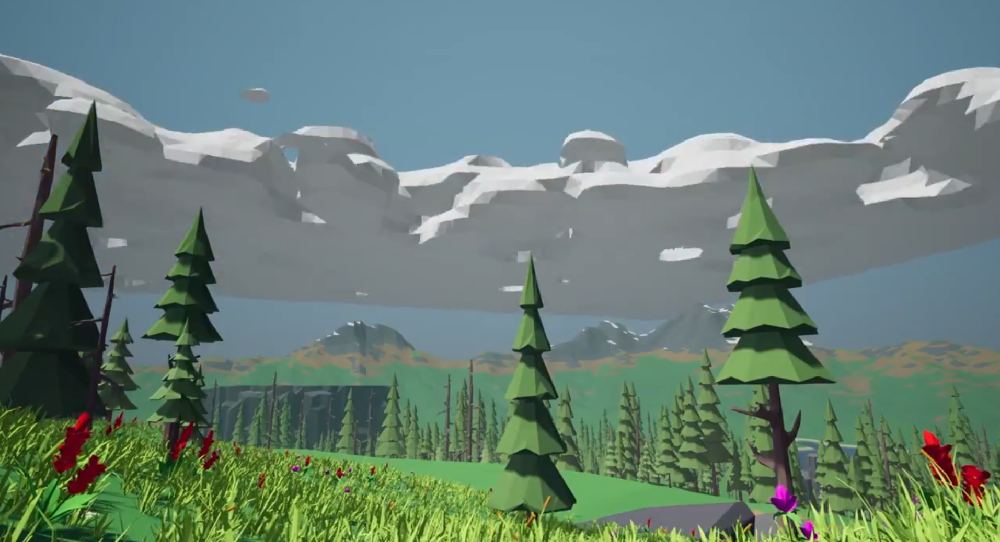
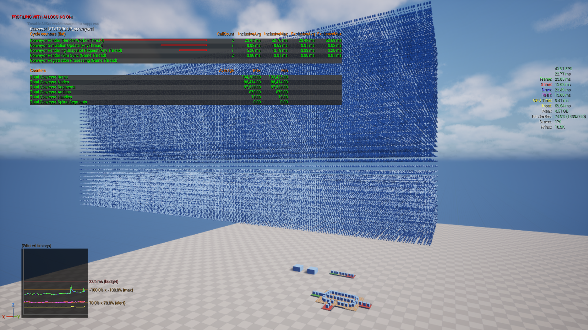

La programmazione è una passione che coltivo da anni e una competenza di supporto al mio lavoro ingegneristico.

- **C++:** progetti personali, algoritmi e sviluppo commerciale, con attenzione alle prestazioni e all’architettura dei sistemi ([progetto di esempio](https://github.com/Theuntextured/LineCounter)).
- **Unreal Engine:** programmazione delle meccaniche di gioco, pipeline di rendering, multithreading e ottimizzazione delle prestazioni.
- **Esperienza professionale:** sviluppo part-time presso TBJBU2 Ltd da dicembre 2023 a ottobre 2025, contribuendo a titoli commerciali attraverso implementazione, integrazione e affidabilità in produzione.
- **Altri linguaggi e strumenti:** C# ([progetto di esempio](https://github.com/Theuntextured/CS2ChaosPlugin)), CMake, CUDA ([progetto di esempio](https://github.com/Theuntextured/ParticlesInSpaceSimulation)).

### Progetti in Unreal Engine

_Rendering in tempo reale di nuvole volumetriche._

_Prova di carico di un [plugin di simulazione di nastri trasportatori che ho pubblicato](https://www.fab.com/listings/7ebfd4f3-eec3-4204-82aa-98b7ff01ec5f)._

[Progetti su GitHub](https://github.com/Theuntextured) · [Pubblicazioni per Unreal Engine su FAB](https://www.fab.com/sellers/The%20untextured%20Dev) · [«Unintended Upgrades», progetto per una game jam](https://the-untextured.itch.io/unintended-upgrades)
